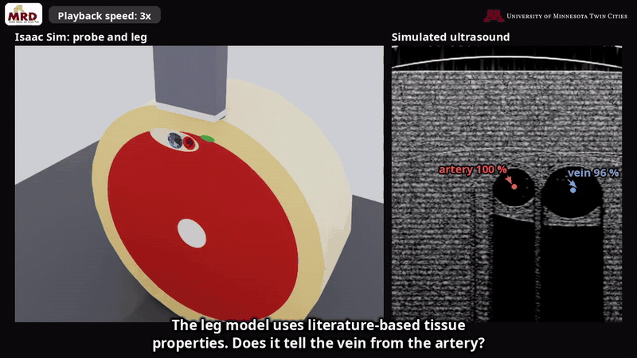
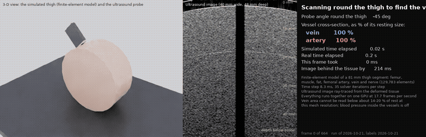
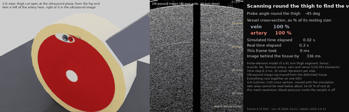

# Physics-Calibrated Simulation of Deformable Tissue for Ultrasound-Guided Robotic Femoral Access

Paper, supplementary material, videos and simulation code for the ISMR 2027 submission.
ISMR is the 2027 International Symposium on Medical Robotics; the paper was submitted through Papercept in November 2026.

A probe presses a simulated femoral leg while a ray tracer renders the ultrasound image of the deforming tissue, live.
The femoral vein closes under the probe while the artery holds its shape.



*Excerpt of the submission video ([full video, 2 min](clips/submission/submission_cutaway_smooth_colours.mp4)).
Left: the simulated probe pressing the cut-open leg. Middle: the live ultrasound image at the paper's chosen setting.
Right: a slower, more accurate setting, which falls behind the probe.*

## Videos

| | |
|---|---|
|  |  |
| **The live run.** ±45° sweep round the limb, then a seven-step press to 25.4 mm. [mp4](clips/final_run/legV5_s2_i35_plain_asrun_18fps.mp4) | **The same run, cut open** at the imaging plane. [mp4](clips/final_run/legV5_s2_i35_cuttex_plain_asrun_13fps.mp4) |

Every clip is in [`clips/`](clips/). Each subfolder's README says what is on screen and what it does not show.

## Contents

| file or folder | contents |
|---|---|
| `main_V5.pdf` | the six-page paper as submitted |
| `supplement.pdf` | the supplementary material: Sections S1–S3, Figs. S1–S9, Tables S1–S9 |
| `figures/` | every figure in the paper and supplement, as 300 dpi PNG |
| `clips/` | the live-run videos (`.mp4`). **The submission video is in `clips/submission/`** |
| [`i4h-phantom/`](i4h-phantom/) | **the simulation code** behind every simulated result, figure, table and video, with install and run instructions |
| `media/` | the animated previews on this page |

## Running the simulation

The code runs beside NVIDIA's [Isaac for Healthcare workflows](https://github.com/isaac-for-healthcare/i4h-workflows),
[Isaac Sim](https://docs.isaacsim.omniverse.nvidia.com/latest/installation/install_python.html) and
[Isaac Lab](https://github.com/isaac-sim/IsaacLab). You clone those, clone this repository next to them, and build one
patched ultrasound container. Isaac Sim and Isaac Lab need no edits.

**[`i4h-phantom/README.md`](i4h-phantom/README.md) has every step**, from cloning NVIDIA's repositories to the
example video, then every figure and table. In short:

```bash
mkdir -p ~/femoral-ws && cd ~/femoral-ws
git clone https://github.com/MRDLab/femoral-sim-calibration.git
# ...clone and build NVIDIA's software as i4h-phantom/README.md steps 2-4 describe, then:
cd femoral-sim-calibration/i4h-phantom
bash run_scripts/example_video.sh        # one live run of the paper's chosen setting, encoded to mp4
```

## What is not here

- **The paper's LaTeX sources.** The paper and supplement are distributed as PDF.
- **The benchtop record.** Frames and measurements of the cast phantom. Table S5 prints every measured value.
- **Raw run outputs** (about 5 GB). The code regenerates them.
